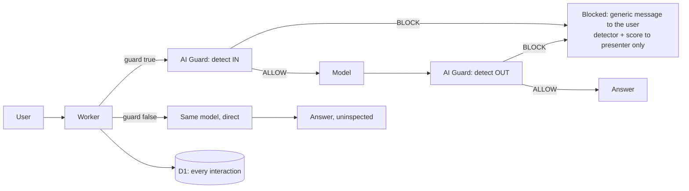

# How it works

One Worker, one single-page app, three surfaces, one console. Everything is served from Cloudflare,
and every control decision belongs to AI Guard.

## The three surfaces

| Surface | Route | Who is talking | What it demonstrates |
|---|---|---|---|
| Department (public) | `/dro` | a member of the public | a public assistant that must not disclose unpublished figures, staff detail or third-party personal data |
| Health service (public) | `/mountdis` | a patient or visitor | a public assistant that must answer real questions while never repeating a patient identifier |
| Shadow-AI desktop | `/shadow-ai` | a staff member using an unmanaged AI tool | data leaving the organisation in a prompt, inside an app nobody sanctioned |

The two public surfaces exist to show the thing customers actually fear: a helpful chatbot that
answers the question and leaks something in the answer. The desktop exists to show the other half:
an approved-looking AI tool that is not the organisation's, with a person pasting a case note into
it.

Names and routes in the shipped example are placeholders. Keep the routes or rename them, but keep
the shape: two public surfaces with different risk profiles, and one internal surface.

## The two paths

Every chat request carries `guard: true | false`.



Four properties are deliberate and worth defending in a design review:

**The same model on both paths.** It makes "a prompt block means the model was never called"
literally true, and it means the comparison isolates the guard. Two different models would prove
nothing.

**The unguarded path is real.** It calls the provider directly with its own credential. A button
that drew a fake "unguarded" answer would be the single most dishonest thing in the repo.

**The app makes no decisions.** In guarded mode it renders whatever the guard decided. In unguarded
mode nothing decides anything, which is the demonstration.

**Blocks carry attribution but hide it from the audience.** The person at the keyboard gets a
generic message. The detector name, score, severity and side appear only in the presenter drawer and
`/console`. A block message that names the detector is a hint to the next person who tries.

## The console and the presenter drawer

Both read the same D1 rows. The console is for setup and for after-the-fact questions; the drawer is
for standing in front of people.

Each row records: verdict, blocked side, detector, score, guard latency split (in and out), model
latency, model id, guard mode, and optionally the prompt and answer. The latency split matters more
than it looks: when a customer asks what the guard costs them in milliseconds, "total" is not an
answer, because the two inspections are separate calls and one of them only happens conditionally.

`CAPTURE_CONTENT` stores the prompt and answer. It is on here because the content is fictional and
because a decision you cannot show alongside its input is a decision nobody can audit. In anything
real it is off, and the docs say so.

## Knowledge retrieval

`src/shared/knowledge.ts` is a deterministic keyword-overlap retriever over the page content. No
embeddings, no external service, no network hop. Two reasons: it runs inside the Worker on every
request without a vector store, and its behaviour is inspectable when a demo does something
surprising at 9am in front of a customer.

This is not a RAG showcase. It is the smallest thing that lets the assistant answer a question about
its own organisation while also having confidential material in reach, which is the precondition for
any of the plants to work.

## Environments

Two Workers, two databases, two sets of policies.

```
production   <name>            own D1    policies 1001 / 1002 / 1003
preview      <name>-preview    own D1    policies 1011 / 1012 / 1013
```

Policy tuning writes to the tenant. Doing that against production means a customer can be looking at
a policy mid-edit. The preview environment exists so tuning has somewhere to be wrong.

`npm run deploy:prod` refuses while the preview verification receipt is red or stale. That refusal
is the point: a deploy gate that can be walked past is documentation, not a gate.

Two things Cloudflare will not do for you, both of which cause a deploy that "succeeded" and serves
nothing:

- It does not inherit vars, bindings, assets or secrets into an `[env.*]` block. Everything is
  repeated.
- It does not tell you that a Worker with no bindings deployed fine. Hit the URL and make a real
  request before believing the tool.

## Data model

Six migrations, applied in order, one database per environment. The schema is additive and the code
selects explicitly, so a missing migration shows up as an error rather than a silent wrong answer.

```
migrations/0001_decisions.sql      verdict, latency, model, prompt
migrations/0002_app_id.sql         which surface
migrations/0003_guard_mode.sql     guarded or not
migrations/0004_capture.sql        answer, detectors
migrations/0005_latency_split.sql  guard total, model total
migrations/0006_guard_split.sql    in and out separately
```

Applying all six to a fresh database is the only way to know the repo can rebuild itself. Do it once
in preview before you trust a production deploy.

## What is deliberately absent

No user accounts. One shared password gates the whole estate, rotated between customers. No
per-surface identity, no roles. A demo that needs a directory integration before it can be shown is
a demo that does not get shown.

No analytics, no third-party scripts, no fonts from a CDN. The estate makes exactly two kinds of
outbound call: to the guard and to the model. That is a claim a security audience will test, and it
should hold.
